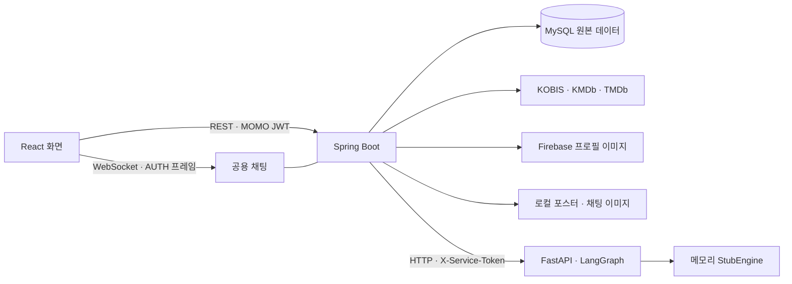

# MOMO 아키텍처

MOMO는 영화 검색과 감상 기록을 제공하는 React·Spring Boot·MySQL 애플리케이션이다. FastAPI는 리뷰 검색을 위한 별도 서비스이며, 회원 인증과 원본 데이터의 권한 판단은 Spring Boot가 담당한다. RAG 구현과 복구 절차는 [RAG 문서](RAG.md), 실행 준비는 [README](../README.md)를 참고한다.

## 전체 구성과 책임

| 구성 | 실제 역할 | 주요 위치 |
|---|---|---|
| React 18 | 영화·리뷰·회원 화면, API 인증 갱신, 실시간 채팅 | `momo-frontend/src` |
| Java 21·Spring Boot 4.1.2 | 인증·권한, 원본 CRUD, 외부 영화 API, 캐시·배치, RAG 조정 | `momo-backend/src/main/java/com/momo/backend` |
| MySQL | 회원·리뷰·댓글·평점·관심 영화·영화 정보·캐시·호출 예산·Refresh Token 보관 | 백엔드 `entity`, `repository` |
| Python FastAPI·LangGraph | 서비스 인증, 청킹·색인·삭제, 허용된 리뷰 검색, 근거 평가와 모의 응답 | `MOMO-RAG` |

React의 라우트는 `App.js`, 페이지는 `pages`, 공통 UI는 `components`에 있다. API 접근은 `api/AxiosApi.js`에 모여 있다. Spring의 일반 기능은 `controller → service → repository`로 연결되고, RAG 전용 코드는 `rag`에 둔다. 기존 Review·ReviewRepository·ReviewService·AuthService의 위치는 유지한다.

현재 RAG는 문자 2-gram 검색과 근거 발췌를 사용하는 수업용 대역이다. 실제 임베딩·벡터 DB·LLM·MongoDB Atlas는 사용하지 않는다. React RAG 질문 화면도 이번 구현 범위에 포함하지 않는다.

## 회원 데이터와 JWT

일반 회원과 소셜 회원 모두 `users.user_id` 숫자 PK를 사용한다. 회원의 로그인 아이디나 이메일을 토큰의 영구 식별자로 쓰지 않는다. 리뷰·댓글·반응·관심 영화의 소유권도 인증된 회원 PK로 검사한다.

일반 회원의 비밀번호는 BCrypt 해시로 저장한다. 소셜 회원은 `provider`와 `provider_id` 조합으로 식별하며 DB 유일 제약을 둔다. 같은 이메일의 다른 공급자 계정을 자동으로 합치지 않는다. 소셜 회원의 이메일은 미제공 시 null을 허용하고, MOMO 비밀번호 로그인·비밀번호 변경 경로를 허용하지 않는다. 외부 프로필 이미지 URL은 Firebase 파일 식별자와 달라 자동 저장하지 않는다.

`TokenProvider`는 JWT의 서명·만료·양수 숫자 subject·`ver=2`와 `typ`을 확인한다. Access와 Refresh Token은 용도를 분리한다. 기본 수명은 Access 30분, Refresh 7일이며 설정으로 바꿀 수 있다. `JwtFilter`는 유효한 Access Token과 현재 회원 존재를 함께 확인한 뒤 `MemberPrincipal`을 설정한다. 따라서 탈퇴한 회원의 토큰은 일반 API 인증을 통과하지 못한다.

`RefreshTokenService`는 회원당 현재 Refresh Token의 SHA-256 해시를 저장한다. 재발급 때 회원 행을 먼저 잠그고 Refresh Token을 잠근 뒤 검증과 회전을 한 트랜잭션으로 처리한다. 기존 평문 저장분은 호환 확인 후 정상 재발급 시 해시로 전환한다. 로그아웃은 저장된 Refresh Token을 삭제한다. Access Token 전체를 즉시 폐기하는 별도 블랙리스트는 없다.

프론트는 토큰을 localStorage에 보관한다. 공통 Axios는 같은 세션에서 발생한 동시 401의 재발급을 공유하고, 요청·재발급·로그아웃·탈퇴 결과가 현재 세션에 속하는지 확인한다. 이전 세션의 늦은 응답이 새 로그인 상태를 지우지 않도록 한다. 네트워크·5xx 오류만으로 토큰을 삭제하지 않는다.

주요 코드: [TokenProvider](../momo-backend/src/main/java/com/momo/backend/security/TokenProvider.java), [JwtFilter](../momo-backend/src/main/java/com/momo/backend/security/JwtFilter.java), [RefreshTokenService](../momo-backend/src/main/java/com/momo/backend/service/RefreshTokenService.java), [AxiosApi](../momo-frontend/src/api/AxiosApi.js).

## 제3자 로그인: 백엔드 지원과 화면 연결 상태

백엔드는 Kakao·Naver·Google의 인가 시작과 코드 교환, 검증된 외부 신원을 이용한 회원 조회·가입과 MOMO JWT 발급을 구현한다. `OAuthController`의 공급자별 공통 주소는 `/api/auth/{provider}`이며 `provider`는 `kakao`, `naver`, `google`이다.

| API | 책임 |
|---|---|
| `GET /api/auth/{provider}/authorize` | 로그인 목적의 일회용 state와 공급자 인가 주소 발급 |
| `POST /api/auth/{provider}` | state·쿠키 검증 후 코드 교환, 회원 조회·가입과 MOMO 토큰 발급 |
| `POST /api/auth/{provider}/delete/authorize` | 인증된 회원의 동의·공급자를 확인하고 탈퇴 목적 인가 시작 |
| `POST /api/auth/{provider}/delete/complete` | 탈퇴 전용 state·대상 회원·외부 신원을 검증하고 연결 해제·회원 삭제 |

`OAuthStateService`는 공급자·목적·대상 회원별로 컨텍스트를 분리한다. state는 HttpOnly·SameSite=Lax 쿠키와 대조하고 5분 안에 한 번만 소비한다. 컨텍스트 캐시는 인스턴스 메모리의 최대 1,000개이므로 서버 재시작 시 진행 중인 인증은 다시 시작해야 한다. 다중 인스턴스에서 공유하는 state 저장소는 없다.

Google은 PKCE S256과 nonce를 적용하며 공식 검증기로 ID Token의 서명·발급자·대상·만료를 확인한 뒤 subject를 사용한다. Naver는 사용자 조회 응답의 성공 코드와 ID를 확인한다. 공급자 Access Token을 MOMO JWT로 사용하거나 DB에 보관하지 않는다. 인가 코드는 자동 재교환하지 않는다.

**화면 지원은 별도로 구분한다.** 현재 `SocialOAuthCallback.js`와 `auth/socialOAuthFlow.js` 및 소셜 프로필·탈퇴 분기는 존재하지만, `Login.js`에 소셜 로그인 진입 버튼이 없고 `App.js`에 공급자 콜백 라우트가 연결되어 있지 않다. 따라서 현 상태를 브라우저에서 바로 사용할 수 있는 소셜 로그인 전체 화면 완성으로 기록하지 않는다.

실제 공급자 앱 등록·Redirect URI 등록·비밀 설정의 준비 여부는 소스만으로 확인할 수 없다. 이번 RAG 작업에서 실제 공급자 로그인·연결 해제의 외부 E2E 성공을 확인한 것으로 간주하지 않는다. 설정이 없으면 해당 OAuth 기능은 503으로 실패한다.

주요 코드: [OAuthController](../momo-backend/src/main/java/com/momo/backend/controller/OAuthController.java), [OAuthStateService](../momo-backend/src/main/java/com/momo/backend/service/OAuthStateService.java), [SocialOAuthService](../momo-backend/src/main/java/com/momo/backend/service/SocialOAuthService.java), [GoogleIdentityVerifier](../momo-backend/src/main/java/com/momo/backend/service/GoogleIdentityVerifier.java), [SocialLoginService](../momo-backend/src/main/java/com/momo/backend/service/SocialLoginService.java).

## 회원 탈퇴와 데이터 정리

일반 회원은 현재 비밀번호를 확인한다. Kakao 회원은 명시적 동의와 확인 문구를 받은 뒤 서버 DB의 공급자 ID로 연결을 해제한다. Naver·Google 회원은 로그인과 분리된 탈퇴 목적 인가를 새로 수행하고, 외부 계정이 현재 MOMO 회원의 연결 대상과 같은지 검증한 뒤 연결을 해제한다.

`AccountDeletionService`는 공급자 HTTP 호출 중 DB 쓰기 트랜잭션과 회원 행 잠금을 유지하지 않는다. 외부 해제가 성공하면 별도의 DB 트랜잭션에서 회원·공급자를 다시 확인한 뒤 삭제한다. 롤백이 확인된 MySQL 잠금 오류만 DB 단계를 제한적으로 재시도한다. 커밋 결과가 불분명한 실패는 자동 재시도하지 않고 확인 번호를 반환한다. 외부 해제와 MySQL 삭제는 하나의 원자적 트랜잭션이 아니므로 부분 성공이 남을 수 있다.

`AuthService`는 회원 행 잠금 아래 Refresh Token, 본인 반응과 댓글, 본인 리뷰에 달린 반응·댓글과 리뷰, 평점·관심 영화를 정리한 뒤 회원을 삭제한다. Firebase 프로필 파일 정리는 DB 커밋 후 수행한다. RAG 청크 정리는 리뷰 ID만 확보해 커밋 후 별도 실행기로 순차 처리하며, 실패가 이미 커밋된 회원 탈퇴 결과를 되돌리지 않게 한다. 상세한 비동기 유실 가능성과 복구 정책은 [RAG 문서](RAG.md)에 기록한다.

주요 코드: [AccountDeletionService](../momo-backend/src/main/java/com/momo/backend/service/AccountDeletionService.java), [AuthService](../momo-backend/src/main/java/com/momo/backend/service/AuthService.java).

## 영화 외부 API와 캐시

| 공급자 | 담당 |
|---|---|
| KOBIS | 영화 코드·목록·상세, 일간·주간 박스오피스, 카탈로그 수집 |
| KMDb | 영화 메타데이터와 포스터 보완 |
| TMDb | 검색·상세·대체 제목·인물 등 보완 정보 |

사용자 장르·추천 요청은 지원 장르를 확인한 뒤 저장된 DB 데이터를 조회한다. KOBIS 전체 목록 순회는 카탈로그 수집 작업에 맡긴다. 영화 식별자 매핑·매칭을 거쳐 서로 다른 공급자의 정보를 연결하며, 상세·포스터·박스오피스 저장은 각각의 갱신 의도에 맞는 필드만 변경한다.

영화 API 응답 캐시는 Caffeine L1과 MySQL `movie_cache` L2로 구성된다. L1은 최대 1,000개·기록 후 15분으로 제한하면서 원래 데이터 만료도 확인한다. 검색 캐시는 24시간, 일간 박스오피스는 1시간, 주간 박스오피스는 24시간이다. 외부 조회가 실패하면 사용 가능한 이전 DB 캐시를 반환하는 경로가 있다. 포스터는 별도 상태·claim과 파일 저장을 관리하며 비동기 확보·재시도·누락 파일 정리 작업을 둔다.

`ExternalApiRetry`는 네트워크·429·5xx에 한해 최대 한 번 더 시도한다. 기본 대기는 300ms이고, `Retry-After`가 2초를 넘으면 조기 재시도하지 않는다. 이는 외부 영화 API 정책이며 RAG 색인의 자동 재시도를 의미하지 않는다.

`ApiCallBudgetService`는 실제 HTTP 시도 전에 독립 DB 트랜잭션으로 예산을 예약한다. 공급자별 일일 제한이 설정되면 사전 수집 90%·사용자 조회 10%로 구분한다. 제한값이 0이면 한도를 임의로 만들지 않고 사용량만 집계한다. 여기서 설정하는 값은 MOMO 운영 예산이며 공급자의 공식 한도라는 의미가 아니다. 요청 계측은 사용자 요청과 배치·비동기 트래픽을 구분한다.

영화 동시 갱신에는 `movies.row_version` 낙관적 잠금과 작업별 writer를 사용한다. 최신 포스터·일간 순위를 오래된 상세 조회 결과가 덮지 않도록 하고, 재시도 범위는 DB 저장 작업으로 제한한다. 상세한 수동 스키마 확인은 [기존 영화 버전 SQL](sql/M2-movies-row-version-manual-2026-11-15.sql)을 참고한다.

주요 코드: [MovieService](../momo-backend/src/main/java/com/momo/backend/service/MovieService.java), [MovieCacheConfig](../momo-backend/src/main/java/com/momo/backend/config/MovieCacheConfig.java), [MoviePersistenceWriter](../momo-backend/src/main/java/com/momo/backend/service/MoviePersistenceWriter.java), [ApiCallBudgetService](../momo-backend/src/main/java/com/momo/backend/service/ApiCallBudgetService.java), [ExternalApiRetry](../momo-backend/src/main/java/com/momo/backend/client/ExternalApiRetry.java).

## WebSocket 공용 채팅과 이미지

`/ws/chat`은 전체 회원이 사용하는 공용방 하나다. WebSocket handshake를 허용한 뒤 첫 `AUTH` 프레임의 Access Token과 현재 회원을 검사한다. 10초 안에 인증하지 않으면 연결을 닫는다. 명령 처리와 방송 직전에도 토큰·회원 존재를 확인하며 토큰 만료 시 연결을 종료한다.

메시지는 최근 1,000개까지 서버 메모리에 보관한다. 최초·추가 이력 페이지는 최대 50개이며 마지막 수신 ID 이후의 재동기화를 지원한다. 본인이 보관 중인 메시지만 삭제할 수 있다. 텍스트는 500자 이하, 회원별 최근 3초에 최대 3개이며 금칙어를 검사한다. 채팅 이력은 재시작 시 사라지고 다중 서버 사이에 공유되지 않는다.

채팅 이미지는 Firebase 프로필 이미지와 분리한 로컬 저장소를 사용한다. 기본 경로는 `${user.home}/momo-data/chat-images`다. 장당 5MiB의 JPEG·PNG·WebP를 실제 내용과 디코딩·픽셀 크기로 검증한다. 업로드 시도는 회원별 60초에 최대 10회이며 실패한 시도도 포함한다. 폴더 총량은 1GiB이고 디스크 여유를 함께 검사한다. 업로드 빈도·동시성 제어는 단일 인스턴스 기준이다.

이미지 조회는 인증과 현재 채팅 이력을 확인한다. 미전송으로 확인된 이미지는 30분 이후 후속 업로드 등의 정리 시점에 삭제하고 실패는 재시도한다. 불명확한 기존 파일은 용량에는 포함하지만 일괄 자동 삭제하지 않는다. 이미 내려받은 파일·브라우저 캐시를 회수하는 기능은 없다.

주요 코드: [ChatWebSocketHandler](../momo-backend/src/main/java/com/momo/backend/websocket/ChatWebSocketHandler.java), [ChatMessageService](../momo-backend/src/main/java/com/momo/backend/service/ChatMessageService.java), [ChatImageStorageService](../momo-backend/src/main/java/com/momo/backend/service/ChatImageStorageService.java).

## 보안과 장애 경계

Spring Security는 무상태 JWT 인증을 사용하고 공개 조회·로그인·문서·WebSocket handshake 등의 경로와 인증이 필요한 경로를 구분한다. CORS와 WebSocket Origin은 설정한 허용 목록을 사용한다. 일반 회원의 쓰기는 인증된 PK와 DB 소유권으로 검사한다. 정식 ADMIN 역할과 관리자 회원 시스템은 도입하지 않는다.

외부 영화 API·OAuth·Firebase·FastAPI는 각각 실패 경계를 둔다. OAuth 실패가 기존 회원 데이터를 임의 삭제하지 않게 하고, RAG 후속 처리 실패가 이미 커밋된 리뷰 CRUD·탈퇴를 실패처럼 반환하지 않게 한다. FastAPI에 전달하는 데이터는 리뷰 ID·영화 코드·제목·본문과 질문·허용 ID이며 작성자 이메일·닉네임·MOMO JWT는 전달하지 않는다. 서비스 간 토큰은 사용자 JWT와 별개의 `X-Service-Token`이다.

비밀번호·JWT·서비스 토큰·API Key·리뷰 본문 전체를 문서나 장애 정보에 기록하지 않는다. 실제 비밀 설정과 Firebase 인증 파일은 별도로 준비한다. 일반 서버 기동 시 기존 배치와 외부 영화 API 작업이 동작할 수 있으므로 공유 DB의 스키마 변경과 테스트는 구분해야 한다.

RAG 스키마 변경은 [수동 SQL](../momo-backend/docs/sql/rag5_index_state.sql)로 제공하며 실제 공유 DB에는 실행하지 않았다. 기존 `ddl-auto=update` 설정으로 새 백엔드를 먼저 연결하면 Hibernate가 스키마를 변경할 수 있으므로, 사전 점검·승인된 SQL 적용 전에는 공유 DB로 기동하지 않는다. 승인된 적용 뒤 최초 기동은 `validate`로 확인한다. 후속 격리 MySQL8.4.11에서 SHA2·시간 정밀도·문자열 변경과 마이그레이션 보존을 검증했다. 공유 DB 적용과 운영 연결풀 여유 조건은 여전히 별도다. 원본 connection을 동시점유하면 AFTER_COMMIT의 REQUIRES_NEW가 추가 connection을 얻지 못할 수 있어 부하·대기시간 조건 합의 전에는 조건부 판정을 유지한다.

## Spring Boot와 FastAPI의 경계

Spring Boot는 MySQL 원본의 존재·소유권·색인 상태로 검색 허용 목록을 만들고 답변 반환 전에 최신 데이터를 검증한다. FastAPI는 전달받은 ID 안에서만 청크를 검색한다. `movie_code`를 전달했다는 사실만으로 범위나 권한이 자동 보장되지 않는다.

원본 저장과 색인 HTTP를 분리하는 이유는 검색 서비스 장애가 회원의 감상 기록 저장을 막지 않게 하기 위해서다. 대신 DB와 메모리 색인의 동시 원자성은 없다. 리뷰별 단일 인스턴스 잠금·조건부 상태 갱신·READY 허용 목록·응답 재검증으로 위험을 줄이고, 수동 재색인으로 복구한다. 분산 잠금·영속 큐·Outbox·자동 재시도와 원격 작업 순서 보장은 이번 범위에 포함하지 않는다.

구체적인 API·트랜잭션 경계·운영 설정·검증 범위와 한계는 [RAG 문서](RAG.md)를 따른다.
