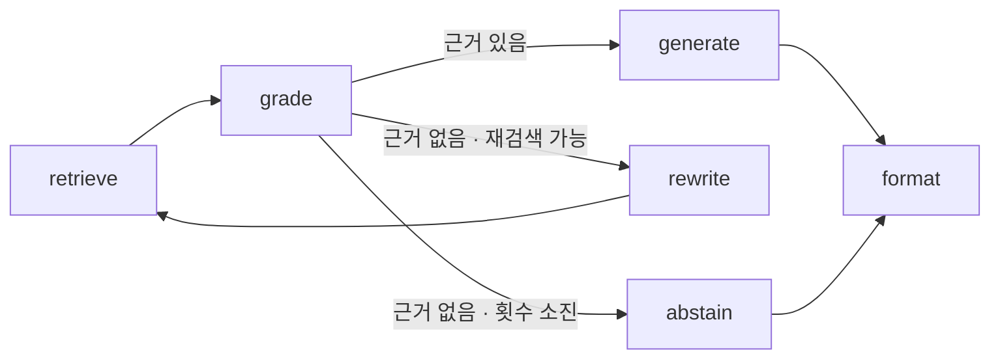

# MOMO RAG — 1~5차시

MOMO RAG는 리뷰를 청킹해 검색하는 FastAPI 서비스와 이를 조정하는 Spring Boot 기능이다. 원본 회원·리뷰·권한·색인 상태는 MySQL에 두고, Python은 Spring이 허용한 리뷰 ID 안에서만 검색한다. 기본 엔진은 **메모리 StubEngine**이며, 6차시부터 명시적으로 선택하는 AtlasEngine이 OpenAI 임베딩·답변 생성과 MongoDB Atlas 검색을 제공한다. 실제 외부 서비스 동작 검증과 Mock 테스트는 구분한다.

5차시에는 색인 상태·커밋 후 이벤트·수동 재색인·회원 탈퇴 청크 삭제·ALL/MINE 질문 API와 반환 전 검증을 추가한다. 기존 LangGraph의 최대 1회 재검색은 유지한다. React RAG 질문 화면은 이번 범위가 아니다.

전체 구성은 [아키텍처](ARCHITECTURE.md), 프로젝트 실행은 [README](../README.md)를 참고한다.

## 서비스와 코드의 역할

| 위치 | 책임 |
|---|---|
| `rag/client/RagClient` | HTTP·내부 DTO·서비스 인증·색인/질문별 타임아웃 |
| `rag/event/ReviewIndexEvent` | 리뷰 ID와 UPSERT/DELETE 작업 전달 |
| `rag/event/ReviewIndexListener` | AFTER_COMMIT 처리, 최상위 장애 격리, 탈퇴 삭제 등록 |
| `rag/service/ReviewIndexService` | 최신 원본 색인·삭제·단건/전체 재색인 조정 |
| `rag/service/ReviewIndexTransactions` | 최신 원본 조회·수동 INDEXING 전환·결과 기록의 분리된 트랜잭션 |
| `rag/service/ReviewLocks` | 고정 256개 stripe 잠금, 결과 기록과 전체 무효화의 세대 조정 |
| `rag/service/RagQueryService` | 질문 검증·허용 목록·HTTP·최신 출처 검증 |
| `rag/service/RagQueryReader` | 독립 읽기 트랜잭션에서 READY 원본 식별 정보 조회 |
| `MOMO-RAG/app.py` | FastAPI lifespan·서비스 인증·색인/삭제/질문 API |
| `MOMO-RAG/engine.py` | 청킹·메모리 저장·2-gram 검색·규칙 재작성·근거 발췌 |
| `MOMO-RAG/graph.py` | LangGraph 검색·평가·재검색·생성/보류·출처 정리 |

기존 Review·ReviewRepository·ReviewService·AuthService의 위치는 유지한다. 이전 RagClient의 TransactionSynchronization 콜백은 커밋 후 이벤트로 대체하며, 두 방식으로 중복 호출하지 않는다. 이벤트에 엔티티 전체나 작성자 개인정보를 담지 않는다.

## 통신과 설정

Spring과 FastAPI는 사용자 JWT와 별개인 `X-Service-Token`으로 인증한다. FastAPI의 `SERVICE_TOKEN`과 Spring의 `RAG_SERVICE_TOKEN`은 같은 비밀값을 별도로 주입한다. 실제 값은 코드·문서·오류 정보·로그에 넣지 않는다. FastAPI는 비어 있는 토큰으로 기동하지 않고 Spring도 토큰 없이 RAG를 활성화하면 기동을 거부한다.

| Spring 설정 | 기본값 | 의미 |
|---|---|---|
| `RAG_ENABLED` | `false` | RAG 전체 활성화 |
| `RAG_BASE_URL` | `http://127.0.0.1:8000` | FastAPI 주소 |
| `RAG_SERVICE_TOKEN` | 없음 | 서비스 인증 비밀값 |
| `RAG_CONNECT_TIMEOUT_MS` | `500` | 색인·삭제 연결 제한 |
| `RAG_READ_TIMEOUT_MS` | `1000` | 색인·삭제 읽기 제한 |
| `RAG_QUERY_CONNECT_TIMEOUT_MS` | `500` | 질문 연결 제한 |
| `RAG_QUERY_READ_TIMEOUT_MS` | `10000` | 질문 읽기 제한 |
| `rag.reindex.enabled` | `false` | 운영자 재색인 기능 활성화 |
| `rag.reindex.operator-ids` | 빈 목록 | 재색인 허용 숫자 회원 PK, 쉼표 구분 |
| `rag.index.lock-wait-ms` | `2000` | 리뷰 stripe 잠금 대기 제한 |
| `rag.purge.queue-capacity` | `100` | 탈퇴 청크 삭제 작업 큐 크기 |
| `rag.query.top-k` | `5` | 검색 청크 수, 1~5 |
| `rag.query.max-allowed-reviews` | `5000` | 질문 허용 리뷰 수 상한 |

질문 타임아웃은 기존 색인·삭제 타임아웃과 분리한다. 5,000개 허용 목록은 현재 개발 환경의 초기 안전장치이며 부하 시험으로 확정한 운영 수치가 아니다. 운영자 PK는 환경별로 관리한다. DB 초기화·회원 ID 재사용이 발생하면 허용 목록을 다시 확인해야 한다. 문서에 임의 운영자 ID를 기본값으로 등록하지 않는다.

Python 설정은 `settings.py`와 추적하지 않는 `.env` 또는 환경변수에서 읽는다.

| Python 설정 | 기본값 | 의미 |
|---|---|---|
| `SERVICE_TOKEN` | 없음 | 필수 서비스 인증값 |
| `CHUNK_SIZE` | `500` | 청크 본문 크기 |
| `CHUNK_OVERLAP` | `80` | 인접 청크 겹침 |
| `STUB_MIN_SCORE` | `0.3` | 2-gram 검색 최소 점수 |
| `MAX_REWRITES` | `1` | 최초 검색 이후 재작성 횟수, 0 또는 1 |

## 색인 상태와 기존 데이터

별도 색인 상태 테이블 대신 `reviews`에 다음 컬럼을 둔다.

| 컬럼 | 형식 | 정책 |
|---|---|---|
| `index_status` | VARCHAR(20), NOT NULL | 문자열 Enum, 초기 `INDEXING` |
| `index_error` | VARCHAR(500), nullable | 실패 분류만 최대 500자 |
| `indexed_at` | DATETIME(6), nullable | 성공한 색인 시각 |

| 상태 | 오류 | 성공 시각 | 검색 |
|---|---|---|---|
| `INDEXING` | null | null | 제외 |
| `READY` | null | 성공 시각 | 허용 |
| `FAILED` | 정제한 실패 분류 | null | 제외 |

`INDEXING`은 미색인·대기·진행을 함께 나타낸다. PENDING은 추가하지 않는다. 신규 리뷰와 기존 미색인 리뷰는 실제 색인 성공 전 READY가 될 수 없다. 비활성화 중의 작성·수정도 INDEXING으로 남기며 외부 호출과 인위적인 FAILED 기록을 하지 않는다.

기존 리뷰는 보존한다. [수동 SQL](../momo-backend/docs/sql/rag5_index_state.sql)은 MySQL 8.x 기준으로 컬럼 존재 여부를 확인해 없는 컬럼만 추가한다. 재실행 시 기존 READY·FAILED·성공 시각을 초기화하지 않으며, 이미 존재하는 컬럼의 타입·기본값을 임의 보정하지 않는다. 최초 적용의 기존 행은 INDEXING/null/null로 시작한다.

적용 전 대상 DB·MySQL 버전·테이블 정의·백업·DDL 잠금 영향을 확인하고, 특히 `updated_at`에 `ON UPDATE CURRENT_TIMESTAMP`가 있으면 중단해 원본 시각 보존 정책부터 확인한다. SQL 실행 후 컬럼 형식·상태별 건수와 적용 전 원본 행 수·제목·본문·updatedAt을 비교한다. SQL은 자동 실행되지 않는다.

**기존 설정은 `ddl-auto=update`이므로 SQL 사전 점검과 승인된 적용 전에 새 백엔드를 공유 DB에 연결해 기동하지 않는다.** Hibernate가 기동 중 스키마를 변경할 수 있기 때문이다. 승인된 변경 후 최초 기동은 `ddl-auto=validate`로 확인한다. 이번 작업에서 공유 DB SQL을 실행하거나 실데이터를 변경하지 않았다. 따라서 실제 공유 DB 적용·재실행·기존 데이터 보존은 아직 검증하지 않은 조건부 항목이다.

## 작성·수정과 AFTER_COMMIT

```text
원본 쓰기 트랜잭션
  리뷰 저장/수정 + INDEXING + UPSERT 이벤트 발행
  COMMIT
    ↓
AFTER_COMMIT 리스너
  리뷰 stripe 잠금
  별도 읽기 트랜잭션으로 최신 원본 스냅샷 조회 → 종료
  FastAPI /index 호출
  별도 REQUIRES_NEW 결과 트랜잭션 → 조건부 READY/FAILED 기록
```

원본 트랜잭션이 롤백되면 이벤트에 의한 HTTP 호출은 없다. 일반 작성·수정에서 INDEXING을 이미 기록했으므로 같은 상태를 불필요하게 다시 UPDATE하지 않는다. 수동 재색인은 INDEXING 전환을 먼저 별도 트랜잭션으로 커밋한다.

HTTP는 새 DB 읽기·쓰기 트랜잭션 밖에서 실행한다. DB 경계는 별도 빈을 통해 적용해 self-invocation으로 REQUIRES_NEW가 무효화되지 않게 한다. 6차시부터 일반 UPSERT는 커밋 후 전용 bounded executor에 등록하여 원격 완료를 기다리지 않는다. 삭제 및 수동 재색인은 기존 실행 방식을 유지한다. 5차시의 동기 연결풀 포화 재현은 아래 이력으로 보존한다.

리스너는 최신 원본 조회·잠금·HTTP·결과 기록·DELETE·비동기 등록에서 발생하는 처리 가능한 RuntimeException을 격리한다. 이미 커밋된 CRUD가 RAG 후속 실패 때문에 실패처럼 응답하지 않도록 하기 위해서다. JVM 치명적 Error까지 무조건 삼키지 않는다. 상태 기록 자체가 실패하면 리뷰 ID와 예외 유형만 안전하게 경고한다. 오류에는 HTTP 상태 또는 예외 클래스 기반 분류를 사용하며 외부 응답 원문·JWT·비밀값·리뷰 본문은 기록하지 않는다.

### 최신 원본 보호와 잠금

UPSERT·DELETE·단건 재색인·전체 재색인은 같은 256개 stripe 잠금을 공유한다. 잠금 객체가 리뷰 수에 비례해 늘지 않으며 서로 다른 리뷰가 같은 stripe로 매핑되면 순차 처리될 수 있다. 기본 2초 안에 잠금을 얻지 못하면 경로별 실패·건너뜀 처리를 한다.

색인 결과 저장 시 현재 행을 잠그고, 전송한 ID·영화 코드·updatedAt·제목·본문과 현재 원본이 모두 일치하며 현재 상태가 INDEXING인지 확인한다. 시각 정밀도만으로 같은 순간의 수정을 판별하지 않는다. 제목·본문은 Java 문자열 동등성을 비교해 DB collation의 대소문자·후행 공백 비교 영향을 피한다. 삭제되거나 더 최신 원본으로 바뀐 리뷰에는 오래된 READY/FAILED를 쓰지 않는다.

색인 상태 전용 UPDATE는 사용자 원본의 `updatedAt`을 바꾸지 않는다. 전체 무효화와 결과 기록은 별도 세대·모니터 경계로 조정해 이전 세대 작업의 늦은 상태 기록을 차단한다. 이 잠금은 단일 Spring 인스턴스 안에서만 유효하다.

## 삭제와 회원 탈퇴

리뷰 삭제는 기존 소유권 확인과 DB 삭제 후 DELETE 이벤트를 발행한다. 커밋 후 공통 삭제 로직으로 `DELETE /index/{review_id}`를 호출한다. DB 롤백 시 원격 삭제는 수행하지 않는다. 이미 없는 청크 삭제는 0개 삭제로 정상 처리한다.

회원 탈퇴는 bulk 삭제 전에 본인 리뷰 ID만 확보해 `ReviewPurgeEvent`로 전달한다. 커밋 후 전용 단일 스레드·유한 큐에 작업 하나를 등록하고, 각 리뷰 ID를 순서대로 공통 삭제한다. 개별 실패 뒤에도 다음 ID를 계속 처리한다. 큐가 가득 차면 AbortPolicy로 등록을 거부하고 요청 스레드에서 원격 삭제를 대신 실행하지 않는다. 등록·실행 실패도 탈퇴 응답에 전파하지 않는다. Firebase 프로필 정리와 기존 소셜 탈퇴 정책은 유지한다.

영속 큐가 없으므로 프로세스 종료·실행 거부 시 미완료 삭제가 유실될 수 있다. 삭제에 실패한 원격 청크가 남더라도 현재 MySQL READY 허용 목록에 없는 리뷰는 질문 검색에서 제외한다. 남은 청크를 자동 전수 정리하는 기능은 없다.

## 단건·전체 재색인

| Spring API | 인증 및 결과 |
|---|---|
| `POST /api/rag/reindex/{reviewId}` | JWT 운영자 전용. `reviewId`, `result`(READY/FAILED/SKIPPED) |
| `POST /api/rag/reindex/all` | JWT 운영자 전용. `total`, `success`, `failed`, `skipped` |

두 API는 유효한 JWT의 숫자 PK, 현재 회원 존재, 재색인 기능 플래그, 운영자 허용 목록, 전체 RAG 활성화를 모두 검사한다. 클라이언트가 보낸 userId는 권한 근거로 사용하지 않는다. 미인증은 401, 비활성 재색인·일반 회원은 403, 허용된 운영자의 전체 RAG 비활성은 503이다. 없는 리뷰의 단건 재색인은 404다.

단건 재색인은 READY·FAILED·INDEXING 어느 상태라도 공통 색인으로 복구할 수 있다. 전체 재색인은 READY를 포함한 모든 ID를 확보해 순차 처리하고, 개별 실패가 다음 리뷰를 중단시키지 않게 집계한다. 자동 재시도·병렬 실행·FAILED 전용 일괄 API는 추가하지 않는다.

전체 재색인은 단일 인스턴스 실행 가드로 중복을 409로 거부하고 예외가 나도 가드를 해제한다. 시작 시 기존 READY를 INDEXING으로 일괄 무효화한다. 이 커밋이 실패하면 순차 작업을 시작하지 않는다. 원본과 updatedAt은 변경하지 않는다. 이후 각 리뷰가 READY로 복구되는 대로 질문에 다시 포함된다. 전체 재색인 중이라는 이유로 질문 전체를 막지 않고 현재 READY만 허용한다.

### StubEngine 재시작 복구

1. FastAPI를 단일 worker로 실행하고 `/health` 및 서비스 인증 연결을 확인한다.
2. Spring의 RAG 활성화·서비스 토큰과 환경별 재색인 운영자 설정을 확인한다.
3. 허용된 운영자의 MOMO Access Token으로 전체 재색인 API를 호출한다.
4. `total/success/failed/skipped`와 안전한 서버 로그를 확인한다. 실패·건너뜀은 원인을 해결한 뒤 단건 또는 전체 재색인으로 복구한다.
5. 현재 READY 데이터로 질문을 확인한다. 운영에 필요하지 않으면 재색인 기능을 다시 비활성화한다.

FastAPI 재시작은 메모리 청크를 없애지만 MySQL READY를 자동 변경하지 않는다. 자동 재시작 감지 기능이 없으므로 재시작·엔진 교체 후 전체 재색인이 필요하다. 기존 READY 무효화는 위 전체 재색인 시작 시 수행된다. 서버 프로세스가 바뀐 사실만으로 자동 복구됐다고 판단하지 않는다.

## 질문 API와 READY 허용 목록

`POST /api/rag/query`는 ALL·MINE 모두 현재 회원의 JWT가 필요하다.

```json
{"question":"이 영화의 연출은 어떤가요?","scope":"ALL"}
```

질문은 앞뒤 공백 제거 후 1~500자이며 scope는 정확히 `ALL` 또는 `MINE`이다. null·공백·길이 초과·알 수 없는 scope는 400으로 거부한다. 리뷰 ID 목록과 회원 ID는 서버가 결정한다.

- ALL: 현재 READY인 모든 회원의 리뷰.
- MINE: 인증된 회원 PK가 작성자인 READY 리뷰만.

허용 목록은 상한+1개만 조회한다. 빈 목록이면 FastAPI를 호출하지 않고 보류한다. 상한을 넘으면 임의로 일부를 잘라 검색하지 않고 안내와 `abstained=true`, 빈 sources/trace를 반환한다. 클라이언트 `top_k`를 신뢰하지 않고 서버 설정을 사용한다.

Spring은 질문 처리의 상위 트랜잭션을 NOT_SUPPORTED로 중단하고, 최초 허용 목록과 최종 출처를 각각 별도 REQUIRES_NEW 읽기에서 조회한다. HTTP 대기 동안 DB 트랜잭션을 유지하지 않는다. 최초 원본 식별 정보는 ID·작성자 PK·updatedAt·제목/본문/영화 코드의 길이 접두어 기반 SHA-256 지문이다. 본문 전체를 허용 목록에 적재하지 않으면서 시각 정밀도·collation 영향을 줄인다. MySQL 경로는 `SHA2`를 사용하고 H2 테스트는 H2 전용 해시식으로 같은 지문 계약을 확인한다. 실제 MySQL의 SHA2 실행·시간 정밀도·문자열 변경은 하단의 별도 격리 MySQL 검증에서 확인했다. H2 통과 기록과 구분한다.

FastAPI에는 `question`, `review_ids`, `top_k`만 전달한다. 작성자 이메일·닉네임·MOMO JWT는 전달하지 않는다. 반환은 `answer`, `abstained`, `sources`, `trace`이며 출처 필드는 `review_id`, `title`, `snippet`, `score`다.

### 응답 재검증 B안

Spring은 출처 ID가 최초 허용 목록에 포함되는지 확인한 뒤 새 DB 조회에서 현재 READY·존재·원본 식별 정보 일치와 MINE의 현재 소유자를 확인한다. 잘못된 응답 구조, 근거 없는 비보류 응답, 알 수 없는 trace도 보류한다. trace는 정해진 그래프 노드 이름만 허용한다.

하나라도 검증에 실패하면 **답변 전체를 안전한 보류 문구로 교체하고 sources·trace를 비운다.** 잘못된 출처만 제거해도 답변 본문에 이전 내용이 남을 수 있기 때문이다. 검증 실패 뒤 자동 재검색·재생성은 하지 않는다. 기존 그래프의 근거 부족 재검색 1회와 이 반환 검증은 별개의 정책이다. FastAPI 연결·읽기 제한 또는 실행 오류는 내부 메시지 없이 503으로 반환한다.

최종 검증 이후에도 실제 응답 전송 직전 리뷰가 수정·삭제될 가능성은 남는다. 분산 스냅샷·원격 작업 버전 프로토콜을 도입하지 않았으므로 이 창을 완전히 없앤다고 보장하지 않는다.

## Python 내부 API와 검색

| API | 입력과 동작 |
|---|---|
| `GET /health` | 공개 상태 응답. status·engine·ready 제공; ready는 그래프 초기화와 Atlas Mongo ping 확인이며 검색 인덱스·OpenAI 성공 보장은 아님 |
| `POST /index` | 서비스 인증. `review_id`, `movie_code`, `title`, `content`, `fingerprint` → ID와 청크 수 |
| `DELETE /index/{review_id}` | 서비스 인증. 양수 리뷰 ID → ID와 삭제 수 |
| `POST /query` | 서비스 인증. `question`, `review_ids`, `fingerprints`, `top_k` → 엔진별 답변·보류·출처·trace |

이 API는 Spring 전용 내부 통신이다. 직접 호출과 사용자용 Spring API의 질문 길이 상한은 모두 500자다. Top-K는 최대 5다. 기존 `board_ids` 입력은 호환하되 `review_ids`가 함께 있으면 이를 우선한다.

StubEngine은 RecursiveCharacterTextSplitter로 본문을 기본 500자·80자 겹침으로 나누고 각 청크에 제목을 붙인다. 같은 리뷰 ID의 UPSERT는 청크 전체를 교체한다. 저장·검색 후보 복사·삭제는 프로세스 내 RLock으로 보호한다. 공백·기호를 제거한 문자 2-gram의 질문 대비 겹침 비율을 점수로 계산하고 최소 0.3 이상만 top-k로 반환한다. 의미 임베딩과 벡터 유사도 점수가 아니다.



`grade`는 엔진이 적용한 임계값을 재계산하지 않고 근거 유무로 분기한다. Stub의 `rewrite`는 요청 표현·물음표를 제거하는 규칙이며 LLM을 호출하지 않는다. Atlas는 제한된 LLM 재작성을 사용한다. 기본 최초 검색+재검색까지 최대 2번 검색한다. 빈 허용 목록은 엔진 검색·재작성 없이 보류한다. Stub의 `generate`는 가장 높은 청크의 본문 일부를 발췌하고, Atlas는 검색된 청크만 LLM 근거로 전달한다. 공통 `format`은 리뷰별 최고 점수 청크 하나와 최대 120자 snippet을 출처로 남긴다. Stub은 여러 리뷰를 종합하거나 새로운 사실을 추론하지 않는다. Atlas도 검색 근거 밖의 사실을 생성하지 않도록 지시하고 인용 검증을 적용한다.

FastAPI는 프로세스 시작 때 엔진·그래프를 한 번 만든다. 그래프 초기화 실패는 색인·삭제까지 중단시키지 않고 질문만 503으로 처리한다. 질문 실행 실패는 내부 정보 없이 500이며 Spring은 이를 사용자용 503으로 변환한다.

## 실행과 검증

저장소 루트의 PowerShell 예시다. 기존 `.venv`가 없으면 먼저 로컬 Python 3.14 환경으로 생성한다. 비밀값은 추적하지 않는 설정에 직접 준비한다.

```powershell
python -m venv .\MOMO-RAG\.venv
.\MOMO-RAG\.venv\Scripts\python.exe -m pip install -r .\MOMO-RAG\requirements.txt
Set-Location MOMO-RAG
.\.venv\Scripts\python.exe -m uvicorn app:app --host 127.0.0.1 --port 8000 --workers 1
```

```powershell
# 저장소 루트에서 시작, DB 접근 없는 Python 검증
Set-Location MOMO-RAG
.\.venv\Scripts\python.exe -m pytest tests -q
Set-Location ..

# Java 21 환경의 기본 백엔드 회귀
.\momo-backend\gradlew.bat -p momo-backend test

# 명시적으로 선택하는 실제 Spring HTTP ↔ FastAPI 통합, H2 전용
$env:RAG_LIVE_TEST='1'
.\momo-backend\gradlew.bat -p momo-backend test --tests '*RagLiveIntegrationTest'
Remove-Item Env:RAG_LIVE_TEST
```

pytest는 검증 환경에 별도로 필요하며 서비스 실행용 `requirements.txt`와 구분한다. 다른 환경은 `RAG_TEST_PYTHON`에 사용할 Python 절대 경로를 전달할 수 있다. 실제 통합은 임시 H2·가상 회원·가상 영화를 사용하고 종료 시 폐기한다. 공유 MySQL의 기존 회원·리뷰를 테스트 자료로 바꾸지 않는다. 격리 MySQL 검증은 별도 실행 조건과 결과를 확인하고 일반 테스트와 구분한다.

### 5차시 검증 결과 — 2026-11-25

이 절의 실행 결과와 당시 제외 범위는 5차시 이력이다. 6차시 변경과 이번 실행 결과는 하단 안내 및 별도 구현 보고서를 따른다.

| 검증 | 결과 및 범위 |
|---|---|
| 백엔드 전체 회귀 | 총 427개: 409 PASS, 실패 0, 18 SKIP |
| 기본 실행의 SKIP | 기존 MySQL 조건 17개 + 명시 선택형 실제 FastAPI 통합 1개 |
| Spring bootJar | PASS, 전체 회귀와 함께 빌드 완료 |
| Python pytest (`pytest tests -q`) | 18 PASS. LangSmith 관련 사용 중단 예정 경고 17건은 테스트 실패와 구분 |
| 실제 Spring HTTP ↔ FastAPI 통합 | 별도 선택 실행 1 PASS. 실제 Spring HTTP의 리뷰 CRUD→이벤트→Python 색인→MINE 정상 답변→삭제 후 ALL 보류, FastAPI 중단 뒤 CRUD 성공. H2 가상 회원·리뷰 사용 |
| 공유 MySQL 스키마·수동 SQL 적용 | NOT RUN. 공유 DB 변경 없음 |
| 실제 MySQL SHA2·updatedAt 정밀도·문자셋 | 추가 검증 PASS(MySQL8.4.11 격리 서버). 공유 DB 적용은 별도 |
| React 자동화·브라우저·외부 OAuth·영화 API·Firebase | 이번 RAG 변경의 신규 검증 범위 아님 |
| 실제 LLM·Embedding·Atlas | 도입하지 않아 검증 대상 아님 |

검증 대상에는 커밋/롤백 이벤트, 분리된 결과 트랜잭션, 색인 상태·최신 원본 보호, 재색인 접근 제어·순차 집계·가드, 탈퇴 청크 삭제·장애 격리, ALL/MINE 허용 목록과 응답 전체 보류를 포함한다. 자세한 테스트 조건은 `momo-backend/src/test/java/com/momo/backend/rag` 및 기존 리뷰·인증 회귀를 따른다. 로컬 H2 기반 통과를 공유 MySQL 적용 완료로 확대 해석하지 않는다. 실DB 도입 판정은 공유 스키마 사전 점검·승인된 수동 적용과 연결풀 운영 조건 확정이 남아 있는 조건부다. 격리 MySQL 경로 검증은 완료했다.

## 한계와 다음 단계

- 단일 프로세스 메모리 색인이라 재시작 시 사라지고 여러 worker 간 공유되지 않는다.
- 리뷰 잠금·전체 재색인 가드·state 세대는 단일 Spring 인스턴스 기준이다.
- 영속 큐·Outbox·자동 색인 재시도·자동 재시작 감지·분산 잠금은 없다.
- HTTP 타임아웃은 원격 작업 취소·완료 순서 보장이 아니다. 타임아웃 뒤 늦게 완료된 원격 UPSERT/DELETE는 로컬 잠금만으로 완전히 통제하지 못한다.
- 최종 DB 재검증 이후 전송 사이의 수정·삭제와 외부 서비스가 반환한 모든 답변 문장의 사실성은 완전히 보장하지 않는다.
- 아래는 5차시 당시 제외 범위 기록이다. LLM·Embedding·Atlas·React RAG 화면은 6차시에서 추가했으며 실제 외부 연결 검증은 별도다. 향후 도입할 때 모델/엔진 전환, 비용·대기시간, 허용 목록 규모와 삭제·버전 정책을 다시 검토한다.

## 강의 참고 자료

강의 예제는 구조·의도를 확인하는 참고로 읽었으며 해당 저장소를 수정하지 않았다.

- [Spring Boot 예제, e311ccd](https://github.com/JBear-ai/mini-prj-SpringBoot/tree/e311ccd029289992e160e802b7d0016530cca484): AFTER_COMMIT 이벤트·색인 상태·재색인·READY 허용 목록.
- [Python 예제, 7457e9f](https://github.com/JBear-ai/rag-ai-service/tree/7457e9fdca783ca01e81adb7e60fee5eff8a9d0f): FastAPI 서비스 토큰·청킹·StubEngine·LangGraph.

MOMO는 게시글 대신 영화 리뷰 ID·영화 코드를 사용하고 작성자 개인정보를 전송하지 않는다. 예제의 원시 오류 저장·HTTP를 포함한 질문 트랜잭션·응답 출처만 필터링하는 방식은 그대로 복사하지 않고, 장애 격리·트랜잭션 분리·응답 전체 보류 정책으로 보완한다. 5차시에는 Atlas/OpenAI를 도입하지 않았다. 6차시 추가 구현과 전환 절차는 아래 별도 항목을 따른다.

## 잔여 MySQL·연결풀 검증 — 2026-11-25

이 절은 **5차시 잔여 검증 당시의 동기 처리 구조**에 대한 기록이다. 6차시는 일반 UPSERT를 제한된 비동기로 변경했다. 초기 전체 회귀427개 기록과 구분하여, 후속 선택 검증80개(기존 MySQL17 + 새 MySQL5 + pool/세대3 + 관련회귀55)가 모두 통과했다. 새 두 MySQL 테스트는 명시 실행 플래그와 임시DB URL 없이는 SKIP한다. Python·프론트 및 전체백엔드 스위트를 이번 후속검증에서 다시 실행하지는 않았다.

별도 임시 datadir·전용포트의 MySQL8.4.11에서 migration SQL 최초/재실행, 가상 기존행3개 원본·INDEXING초기값·READY/FAILED상태 보존, SHA2 UTF-8지문·DATETIME(6)·같은시각의 대소문자/한글/악센트/공백 변경검출·상태변경시각보존을 확인했다. 실제 MySQL에서 세대무효화중 이전 HTTP결과는 SKIPPED, 새결과는 READY가 됐으며 bounded 완료했다. 공유DB는 변경하지 않았다.

**연결풀 한계는 남아 있다.** pool10·동시원본8은535ms에 READY8로 완료했지만, 원본connection10을 barrier로 계속 보유시키면 REQUIRES_NEW가 추가connection을 얻지 못했다. 연결대기를1초로축약한 시험에서1057ms에 예외격리 후 원본commit10/INDEXING10으로 반환했고 수동재색인복구가성공했다. 이는 고갈조건의 재현·격리가 PASS라는 뜻이며 고갈없는 운영을 보장하지 않는다. 기본30초대기나자연발생빈도는실측하지 않았다.

P0-1/P0-2는 격리MySQL범위에서 PASS로갱신한다. P1-1은 운영총동시수·pool여유·대기시간조건이확정되지않아 PARTIAL이다. 동기 AFTER_COMMIT와 REQUIRES_NEW 구조는변경하지 않았으며 운영자원조건합의까지 최종 CONDITIONAL PASS를유지한다. 8/10의관측값을모든환경의안전상한으로일반화하지않는다. Spring의 [REQUIRES_NEW 자원 설명](https://docs.spring.io/spring-framework/reference/data-access/transaction/declarative/tx-propagation.html)도참고한다. 공유DB migration은여전히승인후별도절차이다.


## 6차시 Atlas/OpenAI 전환과 사용자 검증

### 구현 경계와 데이터 계약

MySQL 리뷰가 원본이며 Atlas 청크는 파생 데이터다. 기존 색인 상태 컬럼과 SQL은 유지한다. 6차시 자체는 새로운 MySQL 스키마 변경을 요구하지 않는다. Python은 `RAG_ENGINE=stub|atlas`로 선택하고 알 수 없는 설정은 기동 오류로 처리한다. Atlas 장애 시 Stub으로 자동 전환하지 않는다. Stub은 OpenAI·MongoDB 연결을 수행하지 않는다.

Spring이 `/index`에 전달하는 `fingerprint`는 기존 RagQueryReader와 동일한 제목·본문·영화 코드 순서의 길이 접두어 SHA-256이다. 문자열 길이는 Unicode 문자 수이며 UTF-8 바이트를 해시한다. `/query`는 `review_ids`와 `fingerprints`(리뷰 ID 문자열→해시)를 전달하고 `Source`도 fingerprint를 반환한다. 개인정보인 작성자 이메일·닉네임은 청크에 저장하지 않는다.

Atlas는 허용 리뷰 ID 사전 필터와 점수 임계값을 적용하고, 현재 해시와 다른 청크를 답변 생성 전에 제외한다. Spring은 반환 출처를 현재 READY 원본과 다시 비교하고 하나라도 어긋나면 답변·출처 전체를 보류한다. 인용 형식은 `[리뷰 #ID]`이며 근거에 없는 ID 인용 또는 인용 없는 생성 답변은 보류한다. 프롬프트의 질문·리뷰는 구분된 데이터이며 리뷰 안의 지시를 따르지 않도록 구성한다. 이 조치는 LLM의 모든 프롬프트 공격을 완전히 차단한다는 보장이 아니다.

### 엔진 초기값과 외부 연결

| 항목 | 초기값 |
|---|---|
| Database / Collection | momo_rag / review_chunks |
| Vector index / vector field | review_vector_index / embedding |
| 허용 ID 필드 | reviewId |
| 임베딩 모델·차원·유사도 | text-embedding-3-small / 1536 / cosine |
| Chat 모델 | gpt-4.1-mini |
| 청크 크기·겹침 | 500 / 80 |
| MIN_SCORE / Top-K / 재작성 상한 | 0.78 / 5 / 1 |

Python의 `.env.example`에는 설정 이름과 예시만 둔다. 실제 `OPENAI_API_KEY`, `MONGODB_URI`, `SERVICE_TOKEN`은 사용자가 추적하지 않는 `.env` 또는 실행 환경에 직접 설정한다. 기존 `.env`는 자동 수정하지 않는다. Health는 `status`와 엔진 종류·준비 여부를 제공하며 OpenAI를 호출하지 않는다. Health의 준비 표시는 실제 벡터 검색 품질이나 유료 API 성공 증명이 아니다.

신규 임베딩을 모두 만든 뒤 시도별 식별자로 저장하고, 저장 성공을 확인한 다음 이전 청크를 제거한다. 고정 크기 리뷰별 잠금과 시도별 정리 조건으로 부분 실패 시 기존 청크를 먼저 삭제하지 않는다. 같은 리뷰·fingerprint·모델/차원·청킹 설정·정상 청크 번호/개수/본문/벡터가 모두 맞으면 임베딩을 재사용한다. 불일치하면 전체 청크를 재생성한다. 분산 트랜잭션·분산 잠금은 도입하지 않는다.

### 비동기 색인과 호출 제한

일반 리뷰 등록·수정만 커밋 후 전용 bounded executor(작업자 2개, 대기열 50개)로 넘긴다. CallerRunsPolicy는 사용하지 않는다. 실행 시 최신 원본을 조회하며 결과는 기존 별도 트랜잭션·원본 비교·실행 세대 검증을 통과해야 저장한다. 수동 재색인은 기존 실행 방식을 유지한다. 삭제·탈퇴 후 정리도 기존 잠금 정책과 함께 유지한다. 프로세스 중단 또는 자원 포화로 남은 INDEXING은 수동 재색인으로 복구한다.

| 제한 | 초기값·경계 |
|---|---|
| Spring 사용자별 질문 | 분당 5회, 동시 1건 |
| Spring 전체 질문 | 한국 날짜별 100회 |
| Python 임베딩 요청 | 한국 날짜별 500회; 색인·검색·재색인 포함 |
| Python LLM 요청 | 한국 날짜별 200회; 재작성·답변 생성 합산 |
| 질문·답변 | 500자 / 생성 출력 최대 500토큰 |
| 자동 재시도 | OpenAI 0회 |

동시 검사·증가는 잠금 안에서 원자적으로 처리한다. 실패한 HTTP 시도도 보수적으로 예약 횟수에 포함될 수 있다. 메모리 카운터는 프로세스 재시작 시 초기화되며 여러 인스턴스 간 공유되지 않는다. 금전적인 절대 예산 상한이 아니므로 단일 인스턴스로 운용한다. 원문 질문·리뷰·인증정보를 로그에 남기지 않는다. 정상 보류(200), 호출 제한(429), 외부 장애(503)를 구분한다.

Python의 개별 호출 초기값은 임베딩 4초·재작성 5초·답변 8초·MongoDB 작업 3초다. 전체 색인/질문 예산도 적용하여 다음 외부 호출을 시작할 남은 시간을 확인한다. Spring Atlas 설정은 연결 500ms·색인 응답 15초·질문 응답 30초를 사용한다(Stub은 500ms/1초/10초). HTTP 타임아웃으로 이미 진행 중인 원격 요청이 취소됐다고 간주하지 않는다. 정확한 설정명과 예산 적용 범위는 `.env.example` 및 구현 보고서를 따른다.

### 사용자 직접 실제 연동 검증

1. Atlas의 DB·Collection을 준비하고 `MOMO-RAG/atlas-vector-index.json`으로 이름 `review_vector_index`의 vectorSearch 유형 인덱스를 생성한다. 차원·cosine·reviewId 등 검색 필터 필드는 제공 JSON과 동일하게 지정하고 준비 완료를 기다린다. DB 접속 계정과 네트워크 허용은 사용자 환경에서 설정한다.
2. Python 실제 비밀값은 직접 설정한다. `RAG_ENGINE=atlas`로 단일 worker를 실행하고 `/health`의 엔진·준비 여부를 확인한다. Health만으로 OpenAI 호출 검증이 완료되지는 않는다.
3. Spring에서 RAG 서비스 토큰·Atlas 응답 타임아웃·운영자 권한을 설정한다. 새로 5차시 스키마가 필요한 공유 DB는 별도 승인·사전 점검 후 적용한다. 승인 전 새 백엔드를 공유 DB에 연결해 기동하지 않는다.
4. `RAG_QUERY_ENABLED=false`로 질문 기능을 비활성화한 상태에서 운영자가 전체 재색인을 실행한다. 기존 Stub READY를 Atlas 완료 상태로 간주하지 않는다. 전체 재색인은 먼저 READY를 무효화하고 성공한 행만 READY로 복구한다. 실패·한도 초과는 확인 후 수동 재시도한다.
5. Atlas에서 reviewId·fingerprint·chunkNo·벡터 차원과 정상 청크 수를 확인한다. 검색 인덱스 반영은 지연될 수 있으므로 READY 직후 검색 실패만으로 데이터 유실로 단정하지 않는다.
6. 제한을 확인한 후 `RAG_QUERY_ENABLED=true`로 질문 기능을 활성화하고 실제 LLM 답변·유효 인용·출처·trace를 확인한다. MIN_SCORE와 응답 시간을 관찰한 뒤 필요한 경우에만 설정을 조정한다.
7. 리뷰 수정 후 이전 해시 근거가 노출되지 않는지, 삭제 후 출처가 사라지는지 확인한다. React 도우미의 ALL/MINE·중복 제출·출처 상세 이동·오류 안내와 리뷰 색인 상태·운영자 재색인을 확인한다.
8. 잔존 삭제 청크 정리는 MySQL의 **전체 현존 리뷰 ID**를 확보해 수동 스크립트의 dry-run 결과부터 검토한다. READY ID만 넘기면 정상 INDEXING/FAILED 리뷰가 삭제 대상으로 분류될 수 있다. 실제 삭제 옵션은 검토 후에만 사용한다.

실제 OpenAI·운영 Atlas 연결, 검색 품질, 인덱스 반영 지연, 운영 지연 시간, 공용 예산 소비는 사용자가 직접 확인하기 전까지 미검증이다. Mock 테스트의 통과를 실제 연동 PASS로 보고하지 않는다.

### 참고한 공식 문서

- [MongoDB Vector Search의 사전 필터와 점수](https://www.mongodb.com/docs/vector-search/query/aggregation-stages/vector-search-stage/)
- [PyMongo 전체 작업 제한 CSOT](https://www.mongodb.com/docs/languages/python/pymongo-driver/current/connect/connection-options/csot/)
- [OpenAI Python SDK의 재시도·타임아웃](https://github.com/openai/openai-python)

Python 추가 환경변수는 `RAG_ENGINE`, `OPENAI_API_KEY`, `MONGODB_URI`, `MONGODB_DB`, `MONGODB_COLLECTION`, `ATLAS_INDEX_NAME`, `OPENAI_EMBEDDING_MODEL`, `OPENAI_CHAT_MODEL`, `EMBEDDING_DIMENSIONS`, `MIN_SCORE`, `DAILY_EMBEDDING_REQUESTS`, `DAILY_LLM_REQUESTS`, `EMBEDDING_TIMEOUT_SECONDS`, `REWRITE_TIMEOUT_SECONDS`, `ANSWER_TIMEOUT_SECONDS`, `MONGO_TIMEOUT_SECONDS`, `INDEX_BUDGET_SECONDS`, `QUERY_BUDGET_SECONDS`다. Spring은 기존 타임아웃 환경변수를 우선하며 `RAG_ENGINE=atlas`일 때 미지정 응답 타임아웃 기본값을 15초/30초로 선택한다. Python 설정이 Spring으로 자동 전파되지는 않으므로 양쪽 실행 환경을 각각 설정한다.

정리 스크립트는 `python cleanup_orphan_chunks.py existing_review_ids.json`으로 대상만 조회한다. 사용자가 전체 원본 ID와 유지보수 시점을 검토한 뒤 `--execute`를 추가해야 삭제된다. 이 작업에서 해당 스크립트로 실제 Atlas에 연결하지 않았다.

작업 거절 표식은 기존 bounded 삭제 실행기로 전달해 원본 커밋 연결을 보유한 요청 스레드에서 새 연결을 기다리지 않는다. 동일 리뷰 잠금·원본·세대를 비교해 FAILED를 기록한다. 양쪽 대기열이 모두 포화되거나 잠금/DB 갱신이 실패하면 표식도 유실되어 INDEXING이 남을 수 있으며, 수동 재색인으로 복구한다. 이는 영속 큐를 도입하지 않은 제한된 비동기 구조의 한계다.


### 6차시 사용자 실제 환경 검증 및 설정 오류 해결

아래 결과는 **사용자가 개인 개발환경에서 실제로 확인한 결과**다. Codex의 Mock·로컬 Stub 자동 검증과 구분하며, Codex는 이 마무리 작업에서 추가 유료 API·운영 Atlas·Seed를 실행하지 않았다.

- Atlas 연결·벡터 인덱스, OpenAI 실제 임베딩, FastAPI AtlasEngine 기동 확인.
- 개별 재색인 및 전체 재색인 10건 성공 확인.
- ALL 전체 검색, MINE 본인 검색 및 타 회원 리뷰 제한 확인.
- GPT-4.1-mini 답변, 질문 재작성·근거 부족 보류, 출처·유사도·fingerprint·trace 확인.
- React AI 도우미, 리뷰 신규 작성 자동 색인, 수정 시 fingerprint·청크 교체, 삭제 시 Atlas 청크 제거 확인.

| 현상 | 확인된 원인·해결 |
|---|---|
| ModuleNotFoundError | 개인 Python 가상환경에 requirements.txt 설치 후 해결 |
| 401 Unauthorized | Python의 SERVICE_TOKEN 환경변수명을 수정하고 재시작하여 해결 |
| 503 Service Unavailable | 초기 재색인 후 RAG_QUERY_ENABLED=true로 설정하고 Spring 재시작하여 해결 |

위 세 문제는 소스 코드 수정 없이 환경설정으로 해결했다. 5차시 대비 6차시의 실제 추가 사항은 선택형 Atlas/OpenAI 엔진·fingerprint 전송/출처 검증·일반 UPSERT 비동기화·공용 요청 제한·React AI 도우미이며, 기존 LangGraph·Stub·색인 상태·재색인·권한·원본 보호 구조를 새로 구현한 것으로 간주하지 않는다.

**종합 판정은 CONDITIONAL PASS를 유지한다.** 실제 외부 연동의 초기 미검증 항목은 사용자 확인으로 보완했지만, 실제 MySQL 동시성 8건은 이번 차시에 SKIP 상태다. 대규모 부하·다중 인스턴스·프로세스 중단 복구·운영 연결풀 포화와 금전적인 절대 예산 제한은 검증 또는 보장하지 않는다. 코드 수정 없이 해결한 설정 문제를 기능 결함 수정 성과로 과장하지 않는다.


### 시연용 Seed — 로컬 테스트 DB에서 사용자 실행

`MOMO-RAG/scripts/seed.py`는 Python 표준 라이브러리만 사용한다. 교수님 Seed의 Spring 회원가입·JWT 로그인·리뷰 작성 흐름을 참고하되 MOMO의 `/api/auth/signup`, `/api/auth/login`, `/api/auth/me`, `/api/reviews/me`, `/api/reviews` 계약으로 구성했다.

- 테스트 로그인 ID `momoRagSeedA`, `momoRagSeedB`; 각 회원이 동일 영화 5편에 서로 다른 리뷰를 작성한다(총10개).
- 영화는 기생충(20183782), 인터스텔라(20149120), 극한직업(20182530), 라라랜드(20161872), 겨울왕국(20135428)이다. 실행 시 기존 Spring 영화 상세 API의 코드·제목을 먼저 확인하며 불일치하면 회원 생성 전에 중단한다. 조회 과정은 기존 영화 API·캐시를 사용할 수 있다.
- 리뷰는 연기·촬영/영상미·음악·연출·스토리를 담은 가상 감상이다. 같은 영화의 긍정/비판 관점 차이를 ALL/MINE 시연에 활용한다.
- 기존 계정은 비밀번호 로그인과 프로필 일치를 확인하고, 기존 리뷰의 영화·제목·본문이 정확히 같을 때만 건너뛴다. 다른 데이터는 수정/삭제하지 않고 중단한다. 같은 비밀번호로 재실행한다.
- 기본 실행은 네트워크 없는 미리보기다. 실행 모드에서는 loopback URL과 `--confirm-local-test-db`를 요구한다. 이 플래그는 **운영자가 Spring의 실제 DB 연결을 별도 로컬 테스트 DB로 확인했다는 확인**이며 URL만으로 DB를 자동 판별하는 기능은 아니다. 공유 DB에 연결된 Spring에는 실행하지 않는다.
- 비밀번호는 숨김 입력 또는 `MOMO_SEED_PASSWORD` 환경변수로 주며 파일·로그에 저장하지 않는다. 실제 비밀값은 예제나 Git에 추가하지 않는다.

저장소 루트에서:

```powershell
# 미리보기만: 네트워크 요청 없음
python MOMO-RAG/scripts/seed.py
# Spring DB 연결을 먼저 직접 확인한 뒤 사용자 실행
python MOMO-RAG/scripts/seed.py --execute --confirm-local-test-db --base-url http://localhost:8111
```

리뷰 작성의 기존 비동기 자동 색인을 사용하며 **전체 재색인을 자동 실행하지 않는다.** Atlas 모드로 사용자가 실행하면 최대10개 신규 리뷰의 임베딩 요청이 발생할 수 있다. READY를 확인한 뒤 각 시드 계정으로 로그인하여 다음 질문을 사용한다.

- ALL: “인터스텔라의 음악과 영상미에 대한 서로 다른 평가는?”
- MINE: “내 리뷰에서 라라랜드의 음악과 스토리를 어떻게 평가했나요?”
- MINE(A/B 비교): “기생충의 연출과 배우 연기에 대한 내 감상은?”
- 보류: “이 리뷰에 없는 제작비와 감독의 다음 작품을 알려주세요.”

이번 마무리 검증은 Seed의 모의 API 테스트12개와 문법 확인만 실행했다. 실제 회원/리뷰 생성·추가 유료 API 호출은 수행하지 않았으며 Seed의 실제 실행 성공은 아직 사용자 확인 전이다.

### GitHub 자동 검증 구성

기존 Backend 전체 테스트·React 전체 테스트/빌드를 유지하고 Backend bootJar 및 Python3.14 RAG 테스트/pip check를 추가했다. 개인 feature/ui-redesign Push와 팀 main 대상 PR에서 검사한다. CI의 RAG 엔진은 Stub이며 Python OpenAI/Mongo 인증정보는 공란이다. 기존 조건부 MySQL/실제 Stub 통합 테스트의 실행 조건을 완화하거나 SKIP을 추가하지 않았다. 기존 선택적 Gemini 리뷰와 Pages 배포는 이번 RAG 테스트와 다른 워크플로다. 실제 실행 결과는 GitHub Actions 및 PR Checks와 최종 보고를 기준으로 확인한다.

기존 main(ab80b3f)의 Browser E2E는 가입 버튼의 예전 문구를 찾아 실패했다. 사용자 승인으로 `auth-flow.spec.js` 선택자 한 곳을 실제 UI 문구 `회원가입`으로 맞췄다. 서비스/UI·가입 가능 상태·이동·로그인·로그아웃 검증은 변경하지 않았다. 수정 후 실제 E2E 결과는 이번 GitHub 실행으로 확인하며 이전 실패 기록과 구분한다.
